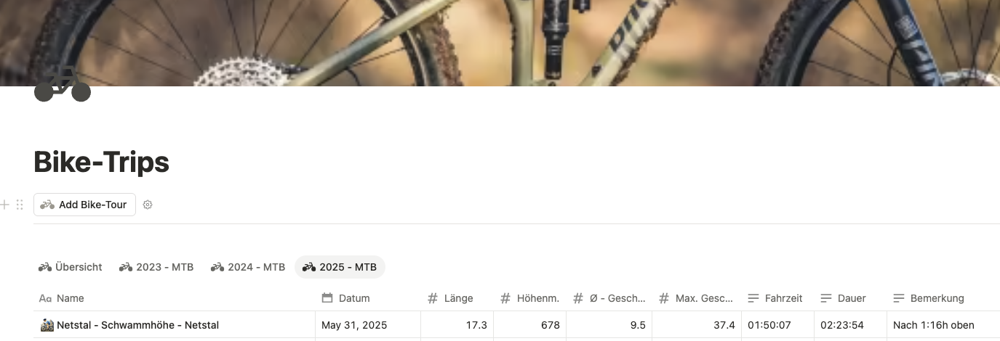

# Strava -> Notion Sync

Synchronisiert Strava-Aktivitäten nach Notion. Aktuell unterstützt das Projekt:

- Bike-Aktivitäten in eine Bike-DB
- Running-Aktivitäten in eine separate Run-DB
- monatliche Zusammenfassungen per Discord



## Setup

```bash
python3 -m venv .venv
source .venv/bin/activate
pip install -r requirements.txt
```

## `.env`

```env
STRAVA_CLIENT_ID=deine_strava_client_id
STRAVA_CLIENT_SECRET=dein_strava_client_secret
NOTION_TOKEN=dein_notion_integration_token
NOTION_DB_ID_BIKE=deine_bike_datenbank_id
NOTION_DB_ID_RUN=deine_run_datenbank_id
DISCORD_WEBHOOK=https://discord.com/api/webhooks/xyz
```

Die Strava-Tokens liegen weiterhin in `stravaToken.json` und werden über `stravaTokenHandler.py` aktualisiert.

## Ausführen

```bash
python uploadToNotion.py
```

Das Skript lädt die letzten 25 Strava-Aktivitäten und routet sie anhand von `sport_type` automatisch in die passende Notion-Datenbank:

- Bike: `Ride`, `GravelRide`, `MountainBikeRide`, `EBikeRide`
- Run: `Run`, `TrailRun`, `VirtualRun`

## Empfohlene Notion-Struktur

### Bike-DB

- `Name` (Title)
- `Datum` (Date)
- `Länge` (Number)
- `Höhenm.` (Number)
- `Fahrzeit` (Text)
- `Dauer` (Text)
- `Ø - Geschw.` (Number)
- `Max. Geschw.` (Number)
- `Art of Bike` (Select)
- `Max. Höhe` (Number, optional)
- `Bemerkung` (Text, optional)
- `Strava URL` (URL)
- `Strava ID` (Text)

### Run-DB

- `Name` (Title)
- `Datum` (Date)
- `Distanz` (Number)
- `Höhenm.` (Number)
- `Laufzeit` (Text)
- `Dauer` (Text)
- `Ø Pace` (Text)
- `Sportart` (Select)
- `Avg HR` (Number, optional)
- `Max HR` (Number, optional)
- `Bemerkung` (Text, optional)
- `Strava URL` (URL)
- `Strava ID` (Text)

## Monatsbericht

```bash
python monthlyReport.py
```

Der Report aggregiert Bike und Run getrennt über ihre jeweiligen Notion-Datenbanken und sendet eine gemeinsame Discord-Nachricht.

## Struktur

- [uploadToNotion.py](/Volumes/fhgr/Code-Projekte/Strava-to-Notion/uploadToNotion.py)
- [monthlyReport.py](/Volumes/fhgr/Code-Projekte/Strava-to-Notion/monthlyReport.py)
- [config.py](/Volumes/fhgr/Code-Projekte/Strava-to-Notion/config.py)
- [stravaTokenHandler.py](/Volumes/fhgr/Code-Projekte/Strava-to-Notion/stravaTokenHandler.py)
